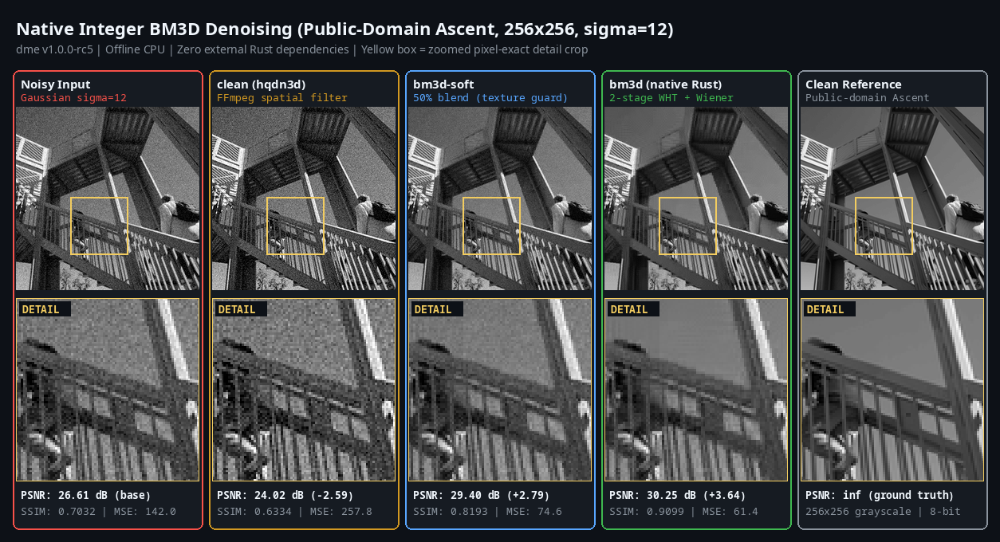
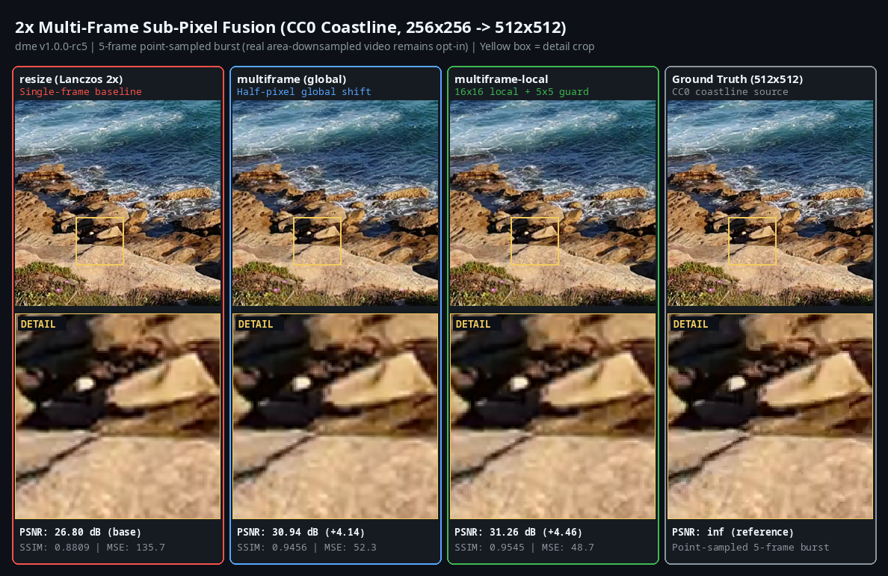
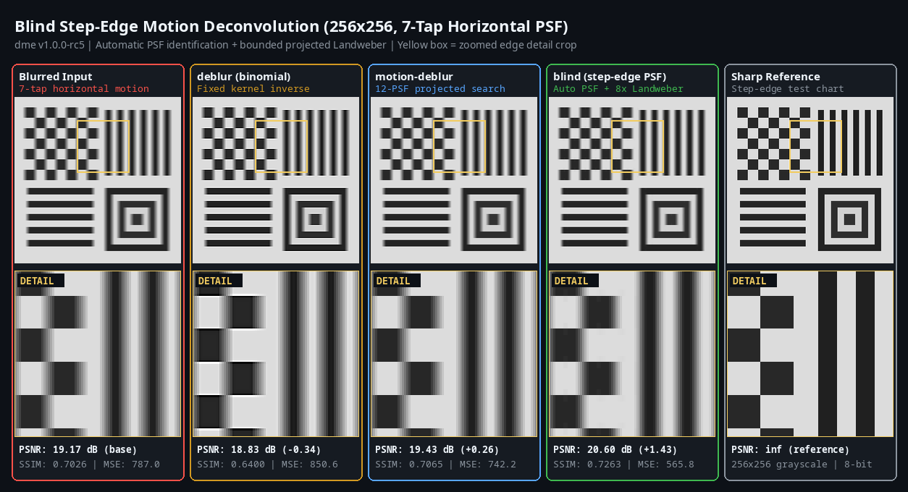

# Deterministic Media Enhancer (DME)

An AI agent skill for local, offline image and video enhancement without trained models, cloud services, telemetry or usage fees. No desktop application or GUI. Start with [SKILL.md](SKILL.md).

## v1.0.0-rc5 — conservative denoising, BT.709 handling and package distributions

The Rust CLI uses FFmpeg CPU filters and has no third-party Rust crate dependencies. Supported scales: 1x, 2x, 4x, 8x. Image output: PNG. Video output: FFV1/FLAC MKV, H.264/AAC MP4, or explicit static HDR10 lossless HEVC/FLAC MKV. Existing outputs are never intentionally overwritten. The CLI is the underlying engine for the agent skill; the supported agent entry point is scripts/agent.py.

| Preset | Operation |
| --- | --- |
| auto (default) | Sample-based defect analysis, candidate comparison and regression guards |
| clean | Spatial denoising, scaling, unsharp |
| detail | Scaling and unsharp |
| resize | Lanczos scaling only |
| restore | Deblocking, fixed-offset debanding, denoising, scaling, unsharp |
| denoise | Non-local means denoising and scaling |
| regional | Threshold-based local smoothing, stronger in flat regions |
| deblur | Damped approximate inverse of a fixed binomial blur kernel plus wider high-boost stage |
| wavelet | Three-level wavelet denoising |
| patch | Experimental single-patch transform denoising (FFmpeg BM3D basic, group=1) |
| bm3d | Native two-stage block matching, integer collaborative transform and Wiener estimate |
| bm3d-soft | Half-strength native BM3D blend for reduced texture loss |
| temporal | Five-frame adaptive temporal denoising (video only) |
| stabilize | Block-motion stabilization (video only) |
| multiframe | Half-pixel global registration and conservative 2x sample fusion (video only) |

## Visual examples

All comparison panels below were generated offline on CPU by `dme` (`v1.0.0-rc5`) using public-domain (`scipy.datasets.ascent`) or CC0 (`shotstack/test-media`) sources and synthetic degradation fixtures. Yellow boxes show zoomed pixel-exact crops.

### 1. Native integer BM3D denoising (Public-domain *Ascent*, 256×256, Gaussian σ = 12)



- `clean` (`hqdn3d`) over-smooths edges and drops PSNR (`26.61 -> 24.02 dB`).
- `bm3d-soft` (50% blend) removes noise while preserving fine texture (`29.40 dB`, SSIM `0.8193`).
- `bm3d` (two-stage integer Walsh-Hadamard + Wiener) improves PSNR by **+3.64 dB** (`30.25 dB`, SSIM `0.9099`) without hallucinated detail.

### 2. 2× multi-frame sub-pixel fusion (CC0 Coastline, 256×256 → 512×512)



- On a 5-frame point-sampled burst with sub-pixel offsets, `multiframe` (`30.94 dB`) and `multiframe-local` (`31.26 dB`, SSIM `0.9545`) recover crisp rock edges over single-frame Lanczos (`26.80 dB`, **+4.46 dB**).
- **Scope note:** On area-downsampled real video excerpts without point-sampled phase shifts, `multiframe-local` remained worse than Lanczos across all six test clips (see [references/validation-rc4.md](references/validation-rc4.md) and [references/validation-rc5.md](references/validation-rc5.md)), so it stays opt-in.

### 3. Blind step-edge motion deconvolution (256×256, 7-tap horizontal PSF)



- `deblur` (fixed binomial inverse) assumes a mismatched blur kernel and introduces edge ringing (`18.83 dB`).
- `blind` automatically identifies the 7-tap axial PSF and applies 8 bounded projected Landweber iterations (`19.17 -> 20.60 dB`, SSIM `0.7263`) while abstaining on ambiguous inputs.

## Benchmark & PSNR / SSIM results

### Single-image denoising comparison (`dme v1.0.0-rc5`, 256×256 8-bit luma)

Measured using the `tests/quality.py` MSE / PSNR / mean non-overlapping 8×8 SSIM harness. **Clean control** runs each denoiser on the clean reference image itself to measure unintended detail loss on noise-free inputs.

| Preset | Ascent (σ = 12)<br>PSNR / SSIM | Ascent (σ = 8)<br>PSNR / SSIM | Synthetic (σ = 8)<br>PSNR / SSIM | Clean control<br>MSE (Ascent / Synth) |
| --- | ---: | ---: | ---: | ---: |
| Noisy input / `resize` | 26.61 dB / 0.7032 | 30.10 dB / 0.8091 | 30.06 dB / 0.6652 | — |
| `clean` (`hqdn3d`) | 24.02 dB / 0.6334 | 27.01 dB / 0.7432 | 27.72 dB / 0.5428 | — |
| `denoise` (`nlmeans`) | 26.61 dB / 0.7032 | 30.20 dB / 0.8152 | 30.18 dB / 0.6719 | — |
| `wavelet` | 26.73 dB / 0.7078 | 30.34 dB / 0.8172 | 30.43 dB / 0.6836 | 0.87 / 0.44 |
| `patch` (FFmpeg BM3D basic) | 29.35 dB / 0.8176 | **33.54 dB** / 0.9443 | 38.63 dB / 0.9351 | 16.45 / 3.12 |
| `bm3d-soft` (50% native) | 29.40 dB / 0.8193 | 32.47 dB / 0.8984 | 34.38 dB / 0.8384 | **0.29 / 0.29** |
| `bm3d` (100% native WHT) | **30.25 dB / 0.9099** | 32.84 dB / **0.9450** | **38.76 dB / 0.9379** | **0.29 / 0.29** |

Notice the clean-control difference: FFmpeg's `patch` alters clean images noticeably (MSE `16.45` on *Ascent*, PSNR `35.97 dB`), whereas native `bm3d` and `bm3d-soft` stay near-lossless when no noise is present (MSE `0.29`, PSNR `53.47 dB`, SSIM `0.9987`).

### Reference corpus & synthetic kernel sweeps (`v1.0.0-rc5`)

| Benchmark | Cases | Baseline MSE / agg. PSNR | `bm3d` MSE / agg. PSNR | `bm3d-soft` MSE / agg. PSNR | Improved (`bm3d` / `bm3d-soft`) | Clean control MSE (`bm3d` / `bm3d-soft`) |
| --- | ---: | ---: | ---: | ---: | ---: | ---: |
| CLIC validation (128×128, ±14 noise) | 102 | 68.59 / 29.77 dB | 48.62 / 31.26 dB | **41.98 / 31.90 dB** | 90/102 / **101/102** | 3.76 / **0.99** |
| EuroSAT grayscale (64×64, ±14 noise) | 2,000 | 69.83 / 29.69 dB | **32.76 / 32.98 dB** | 33.94 / 32.82 dB | 1,815/2,000 / **1,998/2,000** | 3.17 / **0.84** |

- **Synthetic kernel sweep (`dme --synthetic-benchmark 1000`):** 1,000 32×32 luma denoising variants reduced aggregate SSE from `63,086,713` to `14,248,507` (`994` improved, `6` unchanged, `0` worse); 1,000 four-frame local fusion sequences reduced center-frame SSE from `1,947,811` to `668,187` (`958` improved, `0` unchanged, `42` worse).

### Deconvolution & 2× multi-frame fusion (`dme v1.0.0-rc5`)

| Task | Preset | MSE | PSNR | SSIM (8×8) | Notes |
| --- | --- | ---: | ---: | ---: | --- |
| 7-tap horizontal blur (256×256) | Blurred input | 787.03 | 19.17 dB | 0.7026 | Step-edge test chart |
| 7-tap horizontal blur (256×256) | `deblur` | 850.55 | 18.83 dB | 0.6400 | Mismatched binomial inverse |
| 7-tap horizontal blur (256×256) | `motion-deblur` | 742.24 | 19.43 dB | 0.7065 | Searches 3/5-tap motion PSFs only |
| 7-tap horizontal blur (256×256) | `blind` | **565.82** | **20.60 dB** | **0.7263** | Identifies 7-tap axial PSF (ID 3) |
| 2× burst SR (CC0, 256→512, luma) | `resize` (Lanczos) | 135.73 | 26.80 dB | 0.8809 | Single-frame center upscaling |
| 2× burst SR (CC0, 256→512, luma) | `multiframe` | 52.35 | 30.94 dB | 0.9456 | Global half-pixel registration |
| 2× burst SR (CC0, 256→512, luma) | `multiframe-local` | **48.66** | **31.26 dB** | **0.9545** | 16×16 local + 5×5 patch guard |

To reproduce locally:

```sh
python3 tests/quality.py build/skill/dme
python3 tests/quality.py build/skill/dme --reference /path/to/authorized.png
build/skill/dme --synthetic-benchmark 1000
```

## Install the agent skill from a package

Both distributions contain the same Rust source, agent interface, SKILL.md, tests and documentation. They do not bundle architecture-specific binaries, install runtime dependencies or execute install hooks. Linux/WSL only; existing Python 3.10+, Rust 1.85+ (Cargo/linker), FFmpeg/FFprobe with libx264/libx265, and Bash are required. npm additionally requires Node 18+.

Registry installation commands (once the corresponding release is published):

```sh
python3 -m pip install deterministic-media-enhancer==1.0.0rc5
# OR: npm install -g deterministic-media-enhancer@1.0.0-rc.5
dme build
dme doctor
dme skill-path
dme enhance --input input.png --output restored.png --preset bm3d-soft
```

Use only one global dme launcher at a time, or isolate each package installation. `dme build` explicitly compiles and runs the tests offline, then installs the verified engine in a source-hash-specific user cache under XDG_CACHE_HOME (default ~/.cache). Optional `dme build --gpu` requires a locally available CUDA compiler/runtime. `dme skill-path` prints the directory containing SKILL.md. For local release artifacts use pip install with the wheel path or npm install with the tgz path. No registry connection is required for enhancement or engine build.

Maintainers: `python3 scripts/package.py --output build/packages-rc5` creates a wheel, Python source archive and npm tarball using existing build/setuptools/wheel/npm; checksums are recorded. `python3 scripts/test_packages.py build/packages-rc5/dist` installs the artifacts into isolated temporary locations and tests them without registry access. See references/validation-rc5.md for measured quality and release verification.

## Build on Linux

Dependencies: Rust 1.85+ with Cargo (including the platform linker; tested with Rust 1.99.0), Python 3, FFmpeg and FFprobe (with libx264 and libx265). A C++ compiler, CMake, Qt, Python package downloads and Rust crate downloads are not required. Build with bash scripts/build.sh; it checks existing local dependencies, builds offline with the lockfile, runs unit and integration tests, and installs the verified native engine at build/skill/dme.

```sh
bash scripts/build.sh
python3 scripts/agent.py doctor
python3 scripts/agent.py analyze --input input.jpg --scale 2
python3 scripts/agent.py enhance --input input.jpg --output output.png --scale 2
python3 scripts/agent.py enhance --input input.mp4 --output output.mkv --scale 2 --preset restore
python3 scripts/agent.py enhance --input input.mp4 --output output60.mkv --preset temporal --fps 60
python3 scripts/agent.py enhance --input input.mp4 --output stable.mkv --preset stabilize
python3 scripts/agent.py enhance --input input.mp4 --output multi.mkv --scale 2 --preset multiframe

```

## Agent interface

See SKILL.md and references/commands.md. Use python3 scripts/agent.py doctor, analyze, enhance or verify-repeat. The wrapper emits one JSON object, reports nonzero failure status, computes SHA-256 of source and output, and supports exact two-run hash comparison. No automatic software installation, network access or output overwrite. The wrapper defaults to 1x and original FPS; the native CLI retains its previous 2x default for compatibility.

## Batch jobs

Use `python3 scripts/agent.py batch --manifest jobs.json --dry-run` to validate an explicit ordered JSON job list without rendering, then omit `--dry-run` to execute. See references/commands.md for the manifest format. Invalid plans (including duplicate canonical targets and existing outputs) abort before any render. Runtime errors are isolated per job; remaining jobs continue, and any failure yields a nonzero exit. Successful outputs remain. The wrapper stages each output privately on the destination filesystem and publishes with a no-replace hard link only after source/engine hashes and required reports pass. Source/engine hash checks detect persistent changes, not adversarial changes restored between checks. No recursive discovery, arbitrary shell commands or automatic output renaming. No universal quality or cross-machine reproducibility guarantee.

## Agent verification and execution limits

Structured reports reject duplicate JSON keys, non-finite numbers (including exponent overflow), malformed objects, conflicting required guards and invalid field types. Every image preset now checks decoded output dimensions against the decoded source dimensions times the selected scale; automatic non-baseline image outputs must also carry a consistent luma/fallback report. Video jobs require exactly one accepted timeline report. The wrapper records SHA-256 for the engine and the FFmpeg/FFprobe executables and checks their hashes again before publication; repeat verification compares these identities as well as source and output hashes. This does not fingerprint dynamically loaded libraries, the operating system or hardware.

The optional global argument `--timeout-seconds` (default 3600, range 1–86400) limits each local subprocess, not the entire batch. Captured stdout and stderr together are limited to 8 MiB per subprocess. On timeout, output overflow or keyboard interruption, the wrapper kills the subprocess group and reaps the parent. Temporary staging is cleaned and unverified outputs are not published. Normal child processes are covered; this is not an operating-system security sandbox. Source files must be trusted and explicitly authorized; symlink races, adversarial source changes restored between checks and indirect local demuxer access are not fully isolated.

## Release-candidate restoration and input validation

The explicit `patch` preset retains FFmpeg's single-patch basic estimator. The `bm3d` preset now uses a native Rust two-stage BM3D-family variant: robust diagonal-residual noise estimation, deterministic 8x8 block matching (groups of 1/2/4), integer Walsh-Hadamard collaborative hard-thresholding, pilot-guided fixed-point Wiener shrinkage, and overlapping tapered aggregation. It is not a bit-for-bit port of the canonical reference DCT/BM3D implementation. No floating-point operations or learned models are used in the native filtering kernel. Sigma below 2 bypasses filtering; sigma is capped at 25. Both presets process 8-bit YUV luma and can remove real texture. Native BM3D leaves chroma samples unchanged before FFmpeg conversion/encoding. It requires at least 32x32, at most 2,073,600 source pixels, and for video near-zero-start constant-frame-rate input with at least three frames. It runs frame by frame; no temporal denoising guarantee. Neither preset is in auto. The explicit bm3d-soft mode blends the native output and input 1:1 with deterministic integer rounding, limiting changes without guaranteeing improvement. On the existing 2,102 development-reference patches, it reduced adverse cases from 197 to 3 versus full strength; some aggregate denoising performance is traded for texture preservation. See validation-rc5.md. The tested FFmpeg 6.1.1 two-pass filter produced substantial errors even with zero sigma, so the native implementation avoids that path. Controlled quality results are not universal; visually inspect outputs and retain originals. The native engine restricts every external FFmpeg/FFprobe media input to the demuxer family matching its file extension. This rejects disguised concat/HLS playlists and mismatched containers; it is not a sandbox or a guarantee against all decoder vulnerabilities or indirect local reads. FFmpeg diagnostic lines are separated from strict JSON reports.

Run `python3 tests/quality.py build/skill/dme` for a deterministic synthetic grayscale noise fixture; optionally supply `--reference /path/to/authorized.jpg --artifacts /path/to/new-qa-directory`. The comparison reports MSE, PSNR and mean nonoverlapping 8x8 SSIM against the same clean reference, with clean-input controls for the new filters. Wall-clock timings are observational. It does not measure general perceptual quality, temporal quality or color fidelity. Doctor checks available filters, encoders, muxers, demuxers and the expected engine version.

## Adaptive analysis

Analyzes a native-resolution central crop (up to 512x512 pixels) in 8-bit grayscale. For video, samples every 15th decoded frame, at most 8 frames from the first 10 seconds. Integer-based metrics estimate high-frequency residuals in locally flat regions, aligned 8-pixel discontinuities, edge gradients and curvature. Median metrics determine eligible candidates. The optimizer (src/analysis.rs) evaluates a bounded, fixed-order set of candidate filters on up to four native-resolution 384x384 central crops, then compares them against the unfiltered samples. Integer scoring rewards measured defect reduction; guards limit mean absolute deviation, edge loss/gain, clipping, and increases in noise or block artifacts. A candidate must pass every sampled frame and beat the baseline score by more than 15 points. Ties preserve the earlier candidate. Otherwise, only Lanczos scaling is applied. JSON exposes candidate scores, acceptance decisions, and the selected chain. Candidate filters operate before scaling. The automatic mode also tests a regional filter and an approximate deblur candidate when eligible. The final image is decoded and, when a non-baseline automatic chain wins, compared against a separately encoded Lanczos-only baseline over overlapping 256-pixel tiles at full output resolution. Any tile exceeding guard thresholds triggers whole-image baseline fallback. This checks 8-bit luma, not color, alpha, temporal or perceptual quality. These are heuristic proxies: fine textures, nonaligned blocks, color artifacts and late scene changes may be missed or misclassified. No guarantee of quality improvement or parameter optimality.

## Output integrity and limits

Output is encoded in a private temporary directory beside the destination and published via an atomic hard link without overwriting an existing file. Failed encodes are not published. Output filesystems must support hard links. Still images are fully decoded for integrity with a 64 Mi-pixel limit; automatic non-baseline outputs receive a full-image luma comparison and may fall back to Lanczos. Manual presets are not overridden. Videos are decoded in full to detect decoder errors. Source and output video timelines are checked for dimensions, frame count, duration and frame cadence before publication. This does not certify visual quality, motion consistency or audio fidelity. Verification adds processing time. The new regional, deblur and wavelet filters explicitly convert to 8-bit YUV 4:4:4 and are not suited to alpha or HDR preservation. Deblur assumes a fixed small blur kernel; it is not blind or general motion deconvolution. The regional preset is locally threshold-adaptive, not a user-defined ROI editor.

## Video processing

The optional fifth positional argument after input/output/scale/preset selects `keep` (default), `30`, `60` or `120` FPS. Motion-compensated interpolation uses FFmpeg MCI with scene-change detection, adaptive overlapping block compensation, and cloned end padding trimmed to the expected frame count. Interpolation runs at source resolution before spatial filtering and scaling; synthesized frames are estimates. FPS conversion currently accepts only near-zero-start constant-rate video with at least three frames and dimensions of at least 32x32; down-conversion is not supported. Timestamp validation is based on microsecond integer arithmetic with a 2 ms cadence tolerance; unusual timestamps, geometry changes and missing timing information may be rejected. Full-frame FFprobe metadata is capped at 64 MiB; exceptionally long videos can exceed that limit. The temporal and stabilization presets use 8-bit YUV 4:4:4. Stabilization can create mirrored edge content and interpolation can introduce motion artifacts. The timeline guard is structural, not a perceptual or A/V synchronization guarantee.

## Multi-frame detail fusion

The experimental `multiframe` preset is implemented in Rust using integer arithmetic for registration, interpolation and blending. A three-frame sliding window aligns neighboring frames using global translations searched on an integer and half-pixel grid, with bidirectional checks. Only shifts providing a new sampling phase and sufficiently low matching error are eligible. The 2x output starts from a fixed-point cubic interpolation; compatible neighboring samples contribute to missing pixel phases with a 2:1 weight per observation relative to the baseline. A per-channel residual threshold rejects incompatible samples. Original center-frame RGB samples at even/even coordinates remain untouched before output encoding. If no neighbor qualifies, cubic interpolation is used. This is not a general optical-flow or iterative super-resolution solver and cannot guarantee better quality than Lanczos or recover all lost detail.

Currently limited to near-zero-start CFR videos, 2x spatial scale, original FPS, at least three frames, 32x32 minimum and 2073600 source pixels maximum. Input is decoded to 8-bit RGB without automatic rotation; supported limited-range BT.709 SDR inputs use explicit BT.709 matrix conversion and output color tags; PQ/HLG or BT.2020 inputs are rejected. Other color spaces are not fully validated; output uses the existing video encoders and timeline guard. HDR, alpha, rotation metadata, nonrigid motion and large camera motion are not supported by the fusion model. The input is streamed through pipes and memory is bounded by the three source frames and one upscaled output frame. JSON reports accepted neighbors and fused pixels. The test suite uses Python 3 to generate synthetic fixtures.

## Determinism

CPU by default, optional CUDA local registration and fusion, restricted FFmpeg CPU flags, single-thread processing, bitexact flags, fixed presets, source metadata removed, file/pipe protocol whitelist. Reproducibility tests compare whole-file bytes and analysis reports across repeated runs in the same environment. Tests also check expected decisions on synthetic patterns. Cross-version/hardware bit identity is not guaranteed. Upscaling is not recovery of lost detail. PNG/FFV1 outputs are losslessly encoded after pixel conversion and filters, not necessarily source-preserving. MP4 is lossy. Alpha processing, HDR/color management, orientation, VFR, and uncommon media require further validation. Audio is re-encoded; subtitles and metadata are not preserved.

## Portable reproducibility verification

Run the following entirely locally; copy the same three generated fixture files to another authorized physical machine, without regenerating them there. Build the same source revision on each machine.

```sh
python3 scripts/repro.py prepare --fixtures build/repro-fixtures
python3 scripts/repro.py record --fixtures build/repro-fixtures --output build/host-a.json
# On the second machine, with the identical fixture files and source:
python3 scripts/repro.py record --fixtures build/repro-fixtures --output build/host-b.json
python3 scripts/repro.py compare build/host-a.json build/host-b.json
```

The recorder checks the fixed 4096-byte integer-kernel golden SHA-256, renders each of 26 CPU cases twice, validates reports, and compares encoded bytes, decoded high-bit-depth raster/PCM and canonical report hashes. It fingerprints source, fixture files, engine and FFmpeg/FFprobe executables and their ldd-resolved libraries where available. The comparator rejects malformed or incomplete manifests and mismatched source/fixture identities. CPU architecture/model and affinity are observational metadata, not independently authenticated hardware evidence. Different toolchain hashes prevent attribution solely to hardware; matching outputs establish repeatability only for the tested cases. libx264 assembly is disabled as an additional CPU-dispatch restriction. External codecs and libraries may still differ across platforms. Independent physical-machine testing is not implied by same-machine affinity tests.

## Advanced explicit presets

- `blind`: conservative step-edge PSF identification over axial 3/5/7-tap motion kernels and symmetric separable binomial kernels. Eight fixed-point regularized projected Landweber iterations; abstains on ambiguous evidence; local extrema and ±16-code-value bounds. Not unrestricted blind deconvolution.
- `motion-deblur`: conservative projected step-edge fitting over twelve uniform motion PSFs (axis/diagonal 3/5-tap, four oblique 3-tap directions); six regularized iterations with ±24-code-value limits. No general spatially varying motion field, rotation blur, rolling shutter or severe blur recovery. Both inverse modes operate on 8-bit luma and are not selected automatically.
- `multiframe-local`: five-frame window, 16x16 LR local half-pixel registration, forward/reverse consistency and 5x5 patch rejection, all three missing 2x sampling phases where observations permit. Center samples preserved before encoding; fallback is cubic. Original global `multiframe` remains available.
- `multiframe-gpu`: same local fusion; integer luma, local bidirectional registration, cubic, patch rejection and blending are offloaded to CUDA. CPU/GPU first-frame comparison required, explicit failure when helper unavailable. Build optional helper after CPU build: `bash scripts/build-gpu.sh` (default sm_89; override DME_CUDA_ARCH for a supported GPU). Requires existing nvcc and CUDA runtime, no downloads. Decoding, encoding, other restoration presets, and verification remain CPU-side. Local measured speedup is workload-specific.
- `precision`: explicit native pixel-format resize for supported 16-bit RGB/RGBA/gray stills or planar 10/12/16-bit video to FFV1 MKV, original FPS only. Checks matching color tags and exact decoded samples at 1x; scales at native depth at 2x/4x/8x. PQ/HLG tags preserved where supported; unsupported stream/frame side data, including mastering display and dynamic HDR metadata, rejected rather than silently lost. Not HDR tone mapping or HDR-aware restoration. Other presets may reduce depth or discard alpha.
- `hdr10`: explicit limited-range BT.2020/PQ 10-bit planar video to lossless HEVC MKV with libx265, original FPS. Requires constant mastering display and content-light side data on every frame; exact integer-rational metadata and decoded scaled samples verified before publication. Rejects unsupported stream/frame side data and changing HDR metadata. H.26x unregistered vendor SEI is not preserved. Not HDR10+, Dolby Vision, tone mapping, or HDR-aware denoising.

Run `build/skill/dme --synthetic-benchmark 1000` for 1,000 synthetic denoising variants and 1,000 four-frame synthetic local-fusion variants (one center evaluated each). This is a kernel sweep, not a 2,000 independent real-media corpus or encoded video benchmark. Report failures as well as aggregate SSE; do not infer universal quality. See references/validation-rc3.md for measured results. For authorized paired real-media corpora, use scripts/corpus.py with the manifest documented in references/commands.md (up to 10,000 pairs). For archive-based grayscale reference sweeps, use scripts/reference_benchmark.py (optional Pillow QA dependency; no dataset downloads in the skill). See references/validation-rc4.md for real-image, video, HDR and CUDA measurements and negative results.

## Planned features

- User-defined ROI and scene-adaptive restoration, chroma/alpha and temporal quality validation.
- Broader blind/motion deconvolution, native BM3D quality/format coverage and multi-frame reconstruction for area-sampled real video; no guarantee of improvement.
- Agent-driven progress, cancellation and expanded validation.
- Advanced scene-aware motion restoration, color management and higher bit-depth validation.
- Reproducible toolchain and independent physical-machine verification; GPU kernels for remaining restoration algorithms.

No network access is needed by the application itself for local inputs. Installing dependencies and using GitHub may require internet access.

## License

[MIT](LICENSE).
